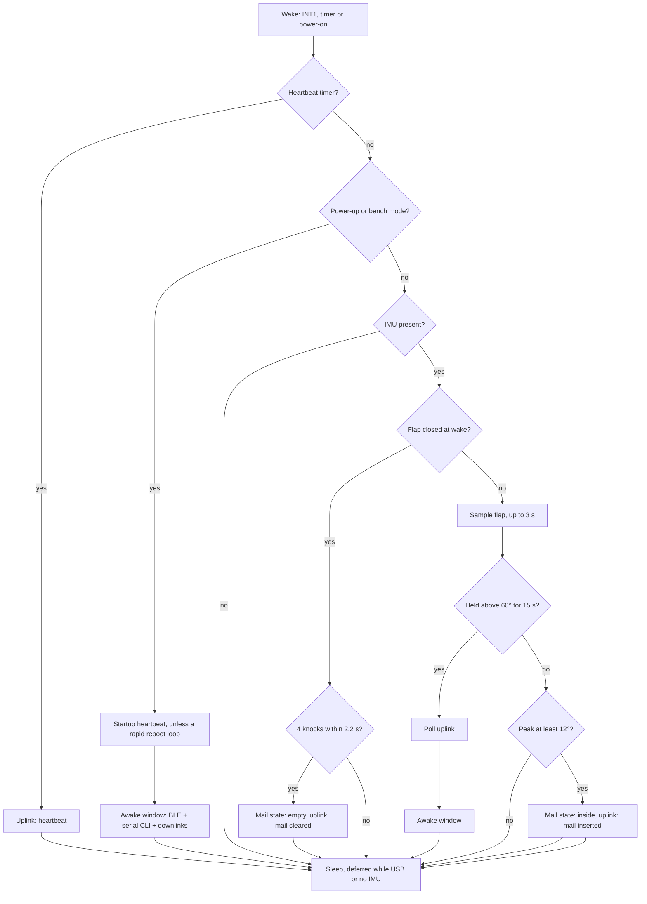
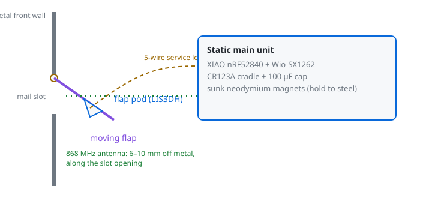
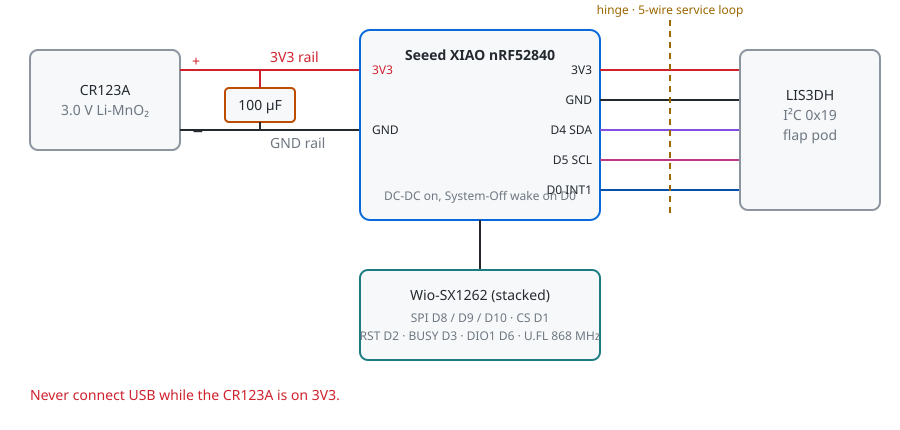

# LoRaWAN Mailbox Tilt Sensor

A battery-powered LoRaWAN sensor node for shared metal mailbox banks (*Briefkastenanlagen*). It mounts on the moving mail flap, measures the flap opening angle and duration, and uses accelerometer reference register latching to prevent infinite wake loops when mail wedges the flap open.

Built on an **nRF52840 + SX1262** hardware stack powered directly from a **3.0V CR123A Lithium** cell. In System-Off mode (`HEARTBEAT_INTERVAL_HOURS 0`) the sleep current is in the **4 to 8 µA** range; the default heartbeat timer keeps the MCU in System-On sleep, which draws more and has not been measured on hardware.

## Wake Flow

The LIS3DH INT1 pin wakes the MCU, which handles one event and sleeps again. With `HEARTBEAT_INTERVAL_HOURS 0` the sleep is System-Off and every wake is a full reboot. With a heartbeat timer the MCU sleeps in System-On so the RTC keeps running, and a wake resumes the loop.



---

## 1. Hardware Requirements

### Component Bill of Materials

| Component | Specification | Function |
| :--- | :--- | :--- |
| **MCU & LoRa Transceiver** | **Seeed XIAO nRF52840 + Wio-SX1262 Kit** (EU868) | 64 MHz Cortex-M4F, ~2 µA deep sleep floor, Semtech SX1262 LoRa radio, U.FL connector with 868 MHz antenna. |
| **Tilt / Motion Sensor** | **LIS3DH / LIS3DHTR** 3-Axis MEMS Breakout (e.g. Seeed Grove or generic) | Measures flap opening angle (0°–90°), generates hardware motion interrupt on INT1 pin (~2 µA @ 1 Hz, 6 µA @ 10 Hz). |
| **Battery** | **1x CR123A Lithium (Li-MnO₂)** (3.0V nominal, ~1500 mAh) | Direct 3.0V supply rail (no LDO regulator losses). Rated from -40 °C to +70 °C with low self-discharge (<1%/year). |
| **Pulse Buffer Capacitor** | **100 µF 16V or 25V Radial Electrolytic** (Low ESR) | Absorbs ~100–118 mA SX1262 LoRa transmit burst when cold temperatures increase battery internal resistance. |
| **Flexible Hinge Harness** | **5-Conductor Ribbon Cable** (or 30 AWG / 0.14 mm² flexible stranded wire) | Flexible service loop across the mailbox flap hinge (3V3, GND, SDA, SCL, INT1). |
| **Chassis Mounting** | **2–3x Neodymium Disc Magnets** (Ø 8×2 mm or 10×2 mm, N35–N52) | Press-fit into the main 3D-printed enclosure to attach securely to the static sheet-steel mailbox interior. |
| **Flap Mounting** | **Double-Sided Outdoor Acrylic Foam Tape** (e.g. 3M VHB or Tesa) | Secures the lightweight moving sensor pod to the inside of the flap. |
| **Enclosure** | **3D-Printed Chassis & Flap Pod** | Printed in **PETG or ASA** (resistant to sub-zero embrittlement and mechanical impact). |

---

## 2. Mechanical Design & 3D Printing

Metal mailboxes act as a **Faraday cage** and subject internal electronics to heavy mechanical shock from incoming catalogs and magazines. This build uses a **Split-Mount Configuration**:



### 2.1 The Two Enclosures
1. **Moving Flap Pod (Sensor Pod):**
   * Houses only the LIS3DH breakout board.
   * Design as a **low-profile 45-degree chamfered wedge** (<10 mm total height). Incoming heavy mail glides over the sloping face without snagging or shearing the sensor off the flap.
   * Attached to the inside of the flap using double-sided acrylic foam tape.
2. **Static Main Unit (Chassis):**
   * Houses the XIAO nRF52840, Wio-SX1262 board, buffer capacitor, and CR123A battery.
   * Mounts to the static inner roof or side partition of the mailbox using **2 or 3 neodymium disc magnets** sunk into the print.
   * **Integrated Battery Cradle:** Model a 17.2 mm diameter semi-cylindrical pocket with two vertical slots at the ends. Bend two tinned wire leads through the slots as contact terminals. The natural flex of the printed plastic wall acts as the spring contact (eliminating the need for a separate commercial battery holder).

### 2.2 Slicing & Filament
* **Filament Material:** **PETG or ASA** (Do **NOT** use standard PLA: PLA becomes brittle below 5 °C and cracks under repeated flap slamming).
* **Walls & Infill:** 3 perimeters, 25% infill (Gyroid or Grid).

### 2.3 The RF Slot-Antenna Technique
Metal mailboxes block RF signals from escaping through sheet metal. However, the horizontal mail slot functions as a **slot antenna aperture**:
* Mount the flexible 868 MHz FPC antenna flat along the inside front lip of the mailbox, directly along the mail slot opening.
* Keep the radiating element spaced **at least 6 to 10 mm away from bare metal** using a 3D-printed standoff to prevent metal detuning.

---

## 3. Electrical Wiring Diagram



### Pin Interconnection Table

| XIAO nRF52840 Pin | Hardware Function | Connection Destination | Location |
| :---: | :---: | :---: | :---: |
| **3V3** | Direct 3.0V Supply Rail | Battery (+) & Sensor VCC | Main Chassis |
| **GND** | System Ground | Battery (-) & Sensor GND | Main Chassis |
| **D7** | I2C SDA (`PIN_ACCEL_SDA`) | LIS3DH SDA | Across Hinge |
| **D6** | I2C SCL (`PIN_ACCEL_SCL`) | LIS3DH SCL | Across Hinge |
| **D0** | Wake Interrupt (P0.02) | LIS3DH INT1 | Across Hinge |
| **D1–D5, D8–D10** | LoRa DIO1, RST, BUSY, NSS, RF_SW (D5), SPI | Wio-SX1262 Board | Internal Pin Headers |

I2C pins are configurable in `include/board.h` (`PIN_ACCEL_SDA` / `PIN_ACCEL_SCL`); the XIAO default is D4/D5, which the Wio-SX1262 occupies.

### Critical Wiring Rules
1. **Direct 3V3 Rail (Bypass LDO):** Connect the 3.0V battery directly to the **3V3 pin** (not VIN/5V). The nRF52840, SX1262, and LIS3DH operate directly down to 1.8V. Bypassing the onboard regulator eliminates quiescent current waste and LDO dropout voltage.
2. **Buffer Capacitor Polarity:** Solder the **100 µF capacitor** directly across 3V3 and GND terminals. Mind polarity: negative stripe (`-`) to GND, long lead to 3V3.
3. **Flashing Safety Warning:** **NEVER plug in a USB-C cable while a non-rechargeable CR123A battery is connected to the 3V3 rail.** The USB port feeds 5V into the board, which can damage a non-rechargeable primary cell. Disconnect the battery before plugging in USB!

---

## 4. The Things Network (TTN v3) Setup

This project uses **LoRaWAN 1.0.4 OTAA (Over-The-Air Activation)** on the **EU868** band.

### 4.1 Registering the Device in The Things Stack Console
1. Log in to your [The Things Network Console](https://console.cloud.thethings.network/) (select your cluster, e.g. Europe 1 / `eu1`).
2. Navigate to **Applications** and select (or create) your application.
3. Click **+ Register end device**.
4. Choose **Enter end device specifics manually**:
   * **Frequency plan:** `Europe 863-870 MHz (SF9 for RX2 - recommended)`
   * **LoRaWAN version:** `LoRaWAN Specification 1.0.4`
   * **Regional Parameters version:** `RP002-1.0.3`
5. Fill in the **Join settings**:
   * **JoinEUI (AppEUI):** Enter `0000000000000000` (16 zeros).
   * **DevEUI:** Click the generate button (or generate a random 16-hex character ID).
   * **AppKey:** Click the generate button (generates a 32-hex character secret key).
   * **End device ID:** Give it a clean name (e.g. `mailbox-sensor-1`).
6. Click **Register end device**.

### 4.2 Applying Credentials & Region to Firmware
Credentials and the PIN live in a gitignored file, [`include/secrets.h`](./include/secrets.example.h); everything else is in [`include/settings.h`](./include/settings.h) (pins are fixed in `include/board.h`). Serial logging is chosen by the PlatformIO env (`release` = off, `debug` = on), not by a setting.

Copy the example and paste the HEX strings directly from the TTN Console (spaces, dashes, colons, or "0x" prefixes are handled automatically):

```bash
cp include/secrets.example.h include/secrets.h
```

```cpp
// include/secrets.h
#define TTN_JOIN_EUI_HEX   "0000000000000000"
#define TTN_DEV_EUI_HEX    "70B3D57ED0060000"
#define TTN_APP_KEY_HEX    "00112233445566778899AABBCCDDEEFF"
#define BLE_AUTH_PIN       "123456"
```

The regional frequency band (`EU868`, `US915`, `AU915`, `AS923`, `KR920`, `IN865`) is `LORAWAN_BAND` in `include/settings.h`.

### 4.3 Setting Up the Payload Formatter
The same file ([`ttn/payload_formatter.js`](./ttn/payload_formatter.js)) is a LoRa Alliance TS013 codec: it provides `decodeUplink`, `encodeDownlink` and `decodeDownlink`.
1. In the TTN Console under your Application, navigate to **Payload formatters -> Uplink**.
2. Set **Formatter type** to **Custom Javascript formatter**.
3. Copy the entire contents of [`ttn/payload_formatter.js`](./ttn/payload_formatter.js) from this repository and paste it into the editor.
4. Click **Save changes**.
5. Repeat steps 1-4 under **Payload formatters -> Downlink** with the same file, so you can queue commands as JSON (`{"action":"heartbeat"}` or `{"action":"clear"}`).

### 4.4 LoRaWAN Payload Specification

#### FPort 1 uplinks
Every uplink is the same fixed 8-byte frame; only the reason differs.

| Byte | Field | Type | Scale / Range | Description |
| :---: | :--- | :---: | :--- | :--- |
| **0** | `reason` | `uint8` | `0x01`-`0x07` | `0x01` mail inserted, `0x02` mail cleared, `0x03` heartbeat (timer), `0x04` heartbeat requested (console or downlink), `0x05` heartbeat on startup, `0x06` heartbeat poll (flap held open), `0x07` manual test (from the console). |
| **1** | `battery` | `uint8` | `(mV - 2000) / 10` | Resting battery voltage in mV (2000–4550). |
| **2** | `battery_sag` | `uint8` | `mV / 5` | Battery voltage drop in mV under LoRa TX load (ESR health check). |
| **3** | `temperature_c` | `int8` | -40 °C to +85 °C | Internal temperature from the on-die sensor. |
| **4** | `mail_inside` | `uint8` | `0`/`1` | Mail-inside state at send time. |
| **5** | `peak_tilt_deg` | `uint8` | 0°–90° | Peak tilt during the flap event. For every other reason: the current tilt. |
| **6** | `resting_tilt_deg` | `uint8` | 0°–90° | Tilt after the flap settled (**> 10° on a delivery means the flap is jammed open**). For every other reason: the current tilt. |
| **7** | `open_duration` | `uint8` | 100 ms steps | How long the flap was open, in ms. `0` for every reason except `mail_inserted`. |

Decoded JSON output example (`mail_inserted`; `is_jammed` and `mail_volume` appear only for this reason):
```json
{
  "reason": "mail_inserted",
  "battery": 3010,
  "battery_sag": 45,
  "temperature_c": 18,
  "mail_inside": true,
  "peak_tilt_deg": 48,
  "resting_tilt_deg": 0,
  "open_duration": 800,
  "is_jammed": false,
  "mail_volume": "large_envelope"
}
```

#### FPort 2 downlinks
One opcode byte: `0x01` send a heartbeat (reason `heartbeat_requested`), `0x02` clear the mail-inside state and send `mail_cleared`. See section 5.3 for when a queued downlink is delivered.

---

## 5. WebBluetooth Diagnostics & Maintenance Interface

To diagnose the sensor, re-calibrate zero, or trigger firmware updates without dismounting the enclosure, a dedicated WebBluetooth instrument console is included in [`web/`](./web/).

* **Online GitHub Pages App:** `https://veronoicc.github.io/mailbox-tilt-sensor/`
* *(Web Bluetooth requires a Secure Context (HTTPS), provided automatically by GitHub Pages).*

### 5.1 Triggering Maintenance Mode
The node has one **awake window** that serves BLE, the USB serial CLI and TTN downlink pickup. It opens in two ways:
1. **Power-up:** whenever the device powers up (battery inserted, USB connected) or reboots, it advertises as **`Mailbox-Sensor`**.
2. **Flap Maintenance Trigger:** When already installed in the mailbox, hold the flap open past **60°** continuously for **15 seconds**. The node sends one poll uplink first, so any downlink you queued in TTN is delivered before the window starts.

**Window lifetime (one setting, `BLE_TIMEOUT_SECONDS`, default 60):** the node stays awake for as long as a BLE client is connected. If nobody is connected, the window closes `BLE_TIMEOUT_SECONDS` after it opened or after the last client left, whichever is later, and the node goes back to sleep.

### 5.2 PIN Authentication & Actions
All BLE commands are protected by a configurable PIN (`BLE_AUTH_PIN` in `include/secrets.h`, default: `123456`):
* **Live Telemetry Stream:** After connecting, the node streams a binary telemetry frame every `BLE_STREAM_DEFAULT_MS` (100 ms): live voltage, core temperature, calibrated pitch, raw 3-axis acceleration, magnitude ($g$), knock count and whether mail is inside. `STREAM <ms>` changes the interval (`0` = off, clamped to `BLE_STREAM_MIN_MS`..`BLE_STREAM_MAX_MS`); it resets on every new connection. Nothing else is sent unprompted.
* **Status on demand:** `STATUS [POWER|IMU|LORA|KNOCK|SYSTEM|ALL]` returns resting voltage and sag, the zero horizon offset, LoRaWAN session status, uplink frame counter (`FCntUp`), last transmitted hex payload, bench/USB state and the firmware version.
* **Knock Pattern Tracker:** Live hit indicator pulses on physical taps, displaying real-time hit counts and peak force ($g$) within the 2200 ms detection window.
* **Test LoRaWAN Uplink:** Transmits an on-demand test packet directly from the browser to verify gateway reception; the reply is followed by a `STATUS LORA` (frame counter, hex payload).
* **Send Heartbeat:** Sends a heartbeat uplink on demand.
* **Clear Mail State:** Marks the mailbox as empty and sends a `mail_cleared` uplink, the same as the knock pattern.
* **Zero Calibration:** Latches the current physical position as the new resting horizon ($0^\circ$).
* **Reset Knocks:** Clears the knock tracker counter.
* **Reboot to DFU:** Reboots the nRF52840 into the UF2 bootloader for USB firmware updates.

### 5.3 Serial CLI and the Command Table
Every command lives in one table in [`src/cmd/cmd.cpp`](./src/cmd/cmd.cpp); BLE, the USB serial CLI and TTN downlinks all run through it, so a new command is one table row.

| Command | Description | Downlink opcode |
| :--- | :--- | :---: |
| `RECALIBRATE` | Set the current position as the zero horizon | - |
| `TEST_UPLINK` | Send a manual test uplink | - |
| `HEARTBEAT` | Send a heartbeat uplink | `0x01` |
| `CLEAR` | Clear the mail-inside state and send `mail_cleared` | `0x02` |
| `RESET_KNOCKS` | Reset the knock counter | - |
| `DFU` | Reboot into the UF2 bootloader | - |
| `SLEEP` | End the awake window and sleep | - |
| `STATUS [POWER\|IMU\|LORA\|KNOCK\|SYSTEM\|ALL]` | Print a status snapshot (default `ALL`) | - |
| `STREAM <ms>` | BLE only: set the telemetry stream interval, `0` = off | - |
| `HELP` | List the commands | - |

* **BLE:** `PIN:<pin> CMD:<NAME> [args]`, e.g. `PIN:123456 CMD:STATUS IMU` or `PIN:123456 CMD:STREAM 100` (used by the web console). The device answers with binary frames (`0x01` telemetry, `0x02` knock, `0x03` reply, `0x04` status), defined in [`src/ble/proto.h`](./src/ble/proto.h) and mirrored by `web/proto.js`. Every state-changing command replies with a `REPLY` followed by the relevant `STATUS`.
* **Serial CLI:** type the bare command, e.g. `test_uplink` or `status imu`, over USB serial (115200). Replies are text lines such as `[OK] Heartbeat sent` or `[STATUS imu] present=1 pitch=...`. It is active during the awake window and needs no PIN, since it needs physical USB access. Toggle with `ENABLE_SERIAL_CLI` in `settings.h`. Nothing is printed periodically.
* **TTN downlink:** FPort 2, one opcode byte. In the TTN console use the formatter's `encodeDownlink` with `{"action":"heartbeat"}` or `{"action":"clear"}`.

**Downlink timing:** LoRaWAN Class A devices only receive right after one of their own uplinks. A queued downlink is delivered after the node's next uplink (a heartbeat, a mail event, or the poll uplink sent when the flap-hold awake window opens), not instantly.

### 5.4 Heartbeat and Mail State
* **Mail state:** the node remembers whether mail is inside across reboots (flash file `/state`, written only when the state changes). It becomes "inside" on a delivery and "empty" on the knock pattern or the `CLEAR` command. It survives a normal reflash but not a chip erase.
* **Heartbeat:** a `heartbeat` uplink carries the mail-inside flag and a reason (`timer`, `startup`, `requested`, `poll`). `HEARTBEAT_INTERVAL_HOURS` (default 24) sets the timer. `HEARTBEAT_ON_STARTUP` sends one after a real power-up or reset, not after a flap wake. If more than `HEARTBEAT_RAPID_REBOOT_MAX` startups happen in a row without a clean sleep, the startup heartbeat is skipped so a boot loop cannot flood the network.
* **Power trade-off:** `HEARTBEAT_INTERVAL_HOURS 0` disables the timer and uses System-Off sleep (lowest drain). Any other value keeps the MCU in System-On sleep with the RTC running so the heartbeat fires on time, which draws more current. This has not been measured on hardware.

### 5.5 Automated GitHub Pages Deployment (No Extra Branch Needed)
The web console in `web/` is automatically deployed via GitHub Actions:

1. In your GitHub repository at `veronoicc/mailbox-tilt-sensor`, go to **Settings -> Pages**.
2. Under **Build and deployment -> Source**, select **GitHub Actions**.
3. Every time you push to `main`, the included workflow ([`.github/workflows/deploy-pages.yml`](./.github/workflows/deploy-pages.yml)) automatically publishes the contents of `web/` to:
   `https://veronoicc.github.io/mailbox-tilt-sensor/`

## 6. Home Assistant Integration

You do **not** need to maintain manual MQTT configuration files. Home Assistant features an official, native **The Things Network** integration:

1. In Home Assistant, go to **Settings -> Devices & Services -> Add Integration**.
2. Search for **The Things Network**.
3. Follow the standard setup wizard to connect your TTN account/cluster.
4. Your mailbox node and its decoded telemetry (`battery`, `peak_tilt_deg`, `reason`, `is_jammed`, etc.) will automatically be discovered as standard Home Assistant entities.

---

## 7. Power & Battery Minimization Architecture

To achieve 10+ years of operational runtime on a single CR123A battery, the firmware implements several aggressive hardware and algorithmic power-saving safeguards:

1. **Dual Hardware DC-DC Buck Converters:**
   * **nRF52840 DC-DC (`DCDCEN = 1`):** Reduces CPU and memory active current draw from ~11 mA down to ~5 mA.
   * **SX1262 DC-DC (`setRegulatorDCDC()`):** Cuts LoRa active TX and RX current consumption by ~40% compared to linear LDO mode.
2. **Early Settling Breakout:**
   * Standard mailbox drops complete in 400–800 ms. Once the flap returns to rest ($< 10^\circ$) and remains motionless for 400 ms, the sampling loop breaks immediately, eliminating up to 2200 ms of active CPU runtime per delivery.
3. **Rapid Knock Abort:**
   * When a vibration wakes the accelerometer, if a 2nd knock does not arrive within 500 ms, the CPU aborts and returns to deep sleep in under 20 ms rather than burning energy on stray noises.
4. **Zero Quiescent Peripheral Leakage:**
   * All onboard RGB LEDs are tri-stated (`pinMode(INPUT)`).
   * Battery voltage comes from the nRF52840's internal VDD ADC channel (`analogReadVDD`), so there is no external divider and no extra leakage path.
   * The BLE radio and SoftDevice stack are completely uninitialized during deep sleep and normal mail deliveries.

---

## 8. Firmware Compilation & Flashing

Firmware is built using PlatformIO.

```bash
# Clone and enter directory
cd ~/Projects/smart/mailbox-tilt-sensor

# Build the release firmware (no serial logging)
pio run

# Flash the debug firmware (serial logging @ 115200) via USB-C (ensure battery is disconnected!)
pio run -e debug -t upload

# Host unit tests (uplink encoder, hex key parser) and formatter test
pio test -e native
node --test ttn/payload_formatter.test.js
```

*(Note: If the upload port is not automatically detected, double-tap the tiny reset button next to the XIAO USB-C port to force UF2 bootloader mode).*
